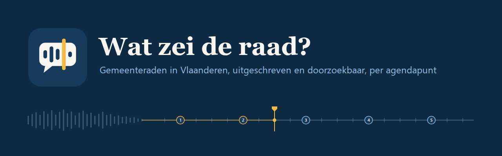
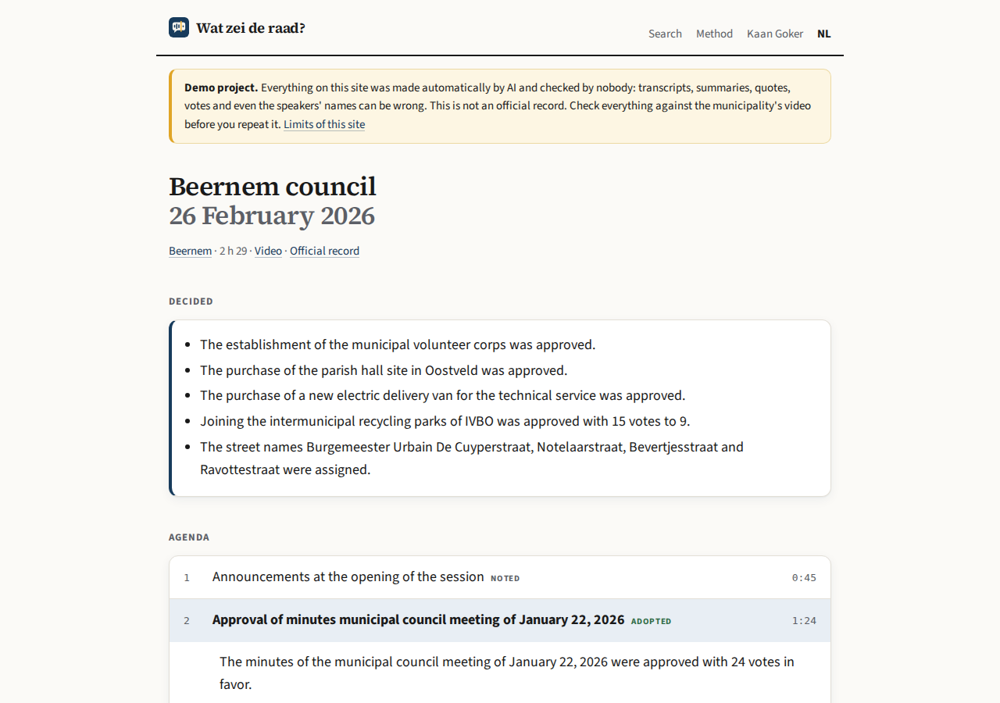
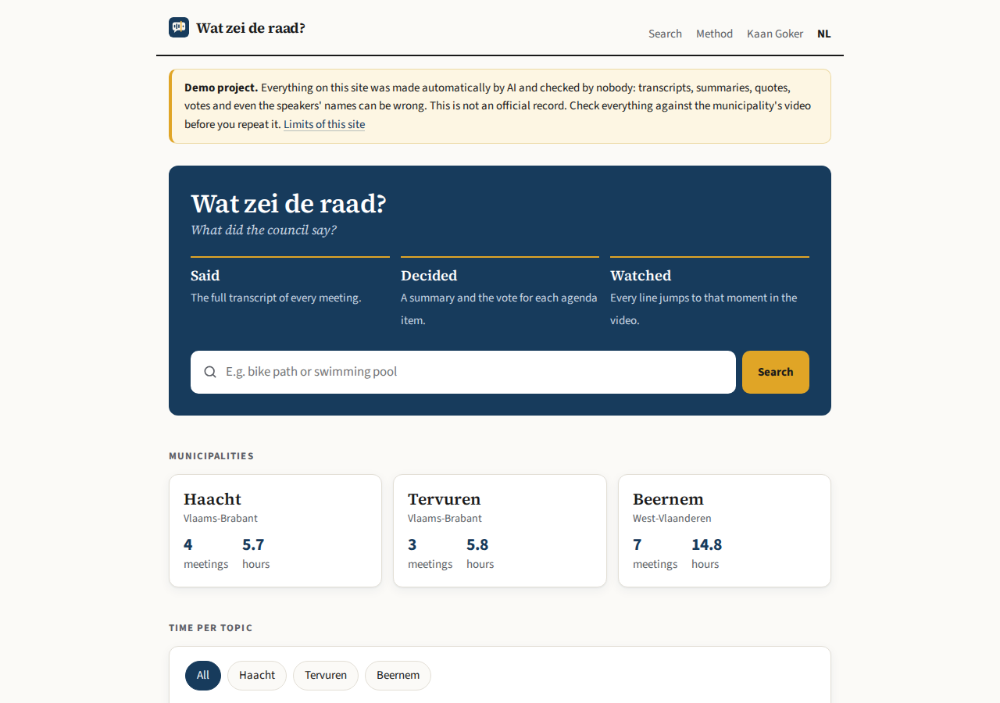
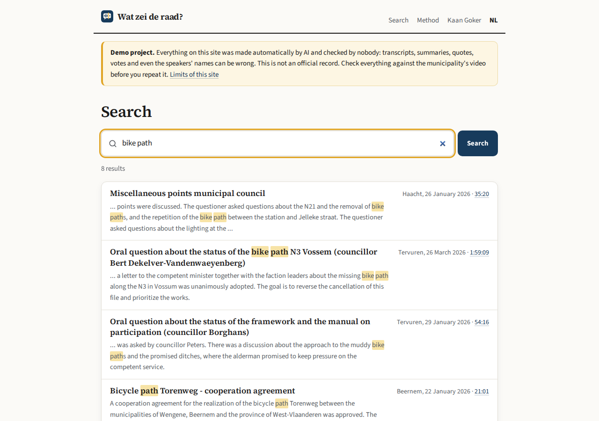

# Wat zei de raad?



Wat zei de raad? turns the council recordings of three Flemish municipalities (14 meetings, 26 hours) into one page per agenda item: a summary checked against the transcript, the official vote, who spoke how long, and the exact second in the municipality's own video. Speech recognition, speaker diarization and LLM summaries, each verified against the transcript or the open data before anything is shown. It is a demo: nobody checked the output by hand, so the municipality's video stays the source.

**Built with:** Python 3.12, faster-whisper (large-v3-turbo), sherpa-onnx with pyannote segmentation 3.0 and 3D-Speaker ERes2Net, sentence-transformers (multilingual MiniLM), Gemini 2.5 Flash Lite and 2.5 Flash, SQLite, SPARQL on Lokaal Beslist and the Mandatendatabank, MiniSearch, a static site on GitHub Pages.

**Site:** [kaangoker.dev/raadzaal](https://kaangoker.dev/raadzaal/) (Dutch and English) · **Numbers:** [EVALUATION.md](EVALUATION.md)



*Beernem, 26 February 2026, in English: the decisions and the agenda with the minute each item starts. Every line of the transcript links to that second in the municipality's video.*

## What it does

Flemish municipalities film their public council meetings and put the whole evening online as one video of one to four hours. Almost nobody watches those. This project splits each recording into its agenda items and gives every item a start time, a short neutral summary, the vote, a quote you can click to hear in context, and a search box across every meeting. The site reads in Dutch or English: summaries, decisions and agenda titles are translated, quotes keep the original Dutch with a translation next to them, and transcripts stay in Dutch as spoken.

The first three municipalities are Haacht, Tervuren and Beernem: 14 meetings of 2026, 26 hours of audio, 333 agenda items of which 286 are placed on the timeline. Adding another municipality is an entry in `municipalities.yaml` with the YouTube channel, a title pattern and, where it exists, the Lokaal Beslist harvester.



*The home page: the three municipalities, a search box, and the time per topic for all of them or one at a time. A questions round is split into two-minute windows, so its time goes to the topics that were raised.*

What the pipeline checks before it shows something:

- **A quote is only shown if it exists in the transcript**, and its time is looked up in the transcript rather than taken from the model.
- **A summary is only shown if the model says the transcript at that spot deals with the item.** Otherwise the item is marked doubtful and gets no summary.
- **Only council members who held a seat on that date can be named** in a summary; everyone else is replaced by a role in a second pass.
- **The vote badge follows the official vote counts**, not the model's reading.
- **A speaker gets a name only on a direct cue from the chair** ("ik geef het woord aan Jos") plus a second cue. A bare name, being the chair, or the name in an agenda title is not enough.



*One search box across 286 agenda items and 26 hours of transcript, every hit linked to the video.*

## How well it works

Where each agenda item starts, compared with 44 starts labelled by hand from the chair's announcements in three meetings. A start counts as found when it is within 60 seconds.

| Meeting | Starts labelled | Found | Placed starts that are right | Median error |
|---|---|---|---|---|
| Haacht, 26 Jan 2026 (no official agenda) | 22 | 100% | 82% | 0.5 s |
| Beernem, 22 Jan 2026 | 9 | 89% | 83% | 0.7 s |
| Tervuren, 26 Mar 2026 | 13 | 100% | 93% | 0.7 s |

Speaker separation reaches a balanced F-score of 0.96 on ten hand-labelled minutes of Beernem (purity and inverse purity, ERes2Net embeddings with a second clustering pass).

Naming speakers is the weak part. 3 of 18 name assignments are backed by a direct cue quoted from the transcript and are shown; the rest are not shown. Names were not checked by ear. Most chairs give the floor with a bare first name or no name at all, so most speaking time stays unnamed and every session page says what share got a name.

The full tables, the per-session numbers and the transcript line behind every name are in [EVALUATION.md](EVALUATION.md).

## How it works

```
municipalities.yaml   channel, title pattern, Lokaal Beslist harvester, exclusions
   |
discover      YouTube Videos and Live tabs, five date formats, commissions and OCMW-only meetings left out
councils      Mandatendatabank (data.lblod.info): members, roles, groups, term dates
agenda        Lokaal Beslist harvester SPARQL: meeting on that date, items in order, votes, public flag
fetch         yt-dlp audio; a download with the same bytes as another meeting is refused
transcribe    faster-whisper large-v3-turbo, CUDA, VAD, word timestamps, hallucination filter
diarise       sherpa-onnx in 45-minute chunks
regroup       one voice embedding per cluster, clusters with the same voice merged
align         Gemini reading as anchors, embedding alignment in between, LLM-only without an agenda
speakers      handover, thanks and self-introduction cues; a direct cue plus a second one
summarise     one Gemini call per meeting, quote, name and placement checks
names         second pass: anyone in a summary who is not on the council is replaced by a role
build         docs/data: index, one JSON per meeting, search corpus, stats
translate     docs/data/en.json: titles, summaries, quotes and decisions in English, keyed by the Dutch text
topics        a questions round split into 2-minute windows, each with its own topic, so "Time per topic" counts what was discussed
report        EVALUATION.md
```

Everything lives in one SQLite file under `data/`; every step can be rerun per meeting. The audio is processed on one laptop and never published. The site is static JSON on GitHub Pages, and every passage links back to the municipality's video, which stays the reference.

## Running it

```bash
python3.12 -m venv venv && ./venv/bin/pip install -r requirements-gpu.txt
curl -fsSL https://deno.land/install.sh | sh     # yt-dlp needs a JavaScript runtime for YouTube
cp .env.example .env                             # GEMINI_API_KEY
./venv/bin/python -m raadzaal discover && ./venv/bin/python -m raadzaal councils
bash scripts/run_pipeline.sh
python -m http.server -d docs
```

Tests run without the models: `pip install -r requirements-test.txt && python -m pytest -q`. `requirements-lock.txt` pins the exact versions the published data was made with.

```
raadzaal/        one module per step, plus config, db, llm
councils/        one YAML per municipality, written by the councils step
prompts/         the Gemini prompts
docs/            the static site (index.html, app.js, style.css, vendor/) and its data
tests/           pytest, with recorded SPARQL answers and hand-labelled item starts
scripts/         pipeline runners, CUDA environment, screenshots
```

Leuven, where I live, is on the list but switched off. Its recordings sit on a webcast service that blocks downloads, so Leuven waits until the city gives permission.

## Data sources

- Recordings: the YouTube channels of the municipalities of [Haacht](https://www.youtube.com/channel/UCmmFija7h5J747aoCunqcKA), [Tervuren](https://www.youtube.com/channel/UCDCfiiYOwr5kcjLWx7ZKkvA) and [Beernem](https://www.youtube.com/channel/UCoMUC2B7Slsem4susLdMJiQ).
- Agendas, vote counts and links to the official files: [Lokaal Beslist](https://lokaalbeslist.vlaanderen.be), Flemish government, through its harvester SPARQL endpoints.
- Council members, roles and groups: the Flemish [Mandatendatabank](https://data.lblod.info/sparql).
- The site stores no audio or video. It links to the second in each municipality's own recording and shows the transcript lines; under Belgian copyright law, speeches made in deliberative assemblies such as a municipal council may be freely reproduced and communicated to the public (Code of Economic Law, art. XI.172 §1).
- Models: [faster-whisper](https://github.com/SYSTRAN/faster-whisper) large-v3-turbo, [sherpa-onnx](https://github.com/k2-fsa/sherpa-onnx) with pyannote segmentation 3.0 and 3D-Speaker ERes2Net, [paraphrase-multilingual-MiniLM-L12-v2](https://huggingface.co/sentence-transformers/paraphrase-multilingual-MiniLM-L12-v2), Gemini 2.5 Flash Lite and 2.5 Flash.

## Limits, privacy and removal

This is a demo project. Everything is made automatically and nobody checked it by hand: transcripts, summaries, quotes, votes and speaker names can all be wrong, and a statement can end up next to the wrong name. Speech recognition makes more mistakes with dialect, bad microphones and people talking over each other.

The site is not an official record. The municipality's video and minutes are the source, and a warning at the top of every page says so. Only public meetings that a municipality published itself are used, and only agenda items marked public. Only council members, the mayor and the aldermen are named, never citizens or municipal staff. The transcript is verbatim, so it holds whatever was said in the room.

If something on the site should not be there, mail nadirkaangoker@gmail.com or open an issue, and I will fix it or take it down.

## License

The code is MIT. The site ships MiniSearch (MIT) and the Source Serif 4 and Source Sans 3 fonts (SIL Open Font License 1.1), all in `docs/vendor/` with their licenses.
